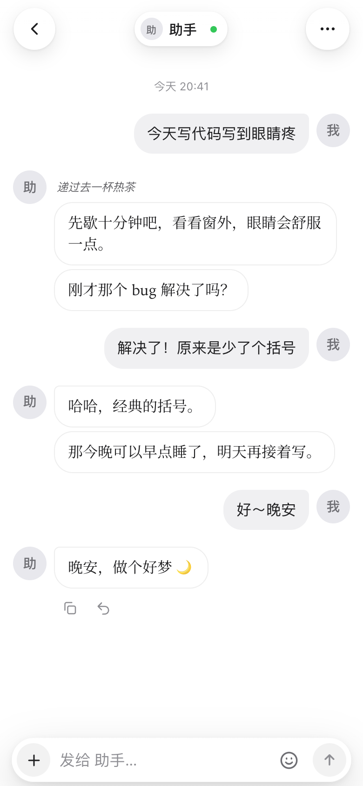
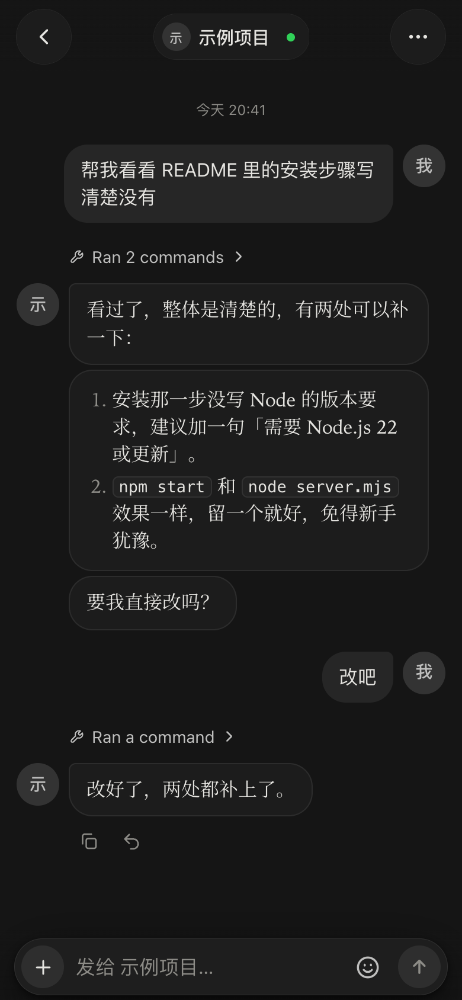
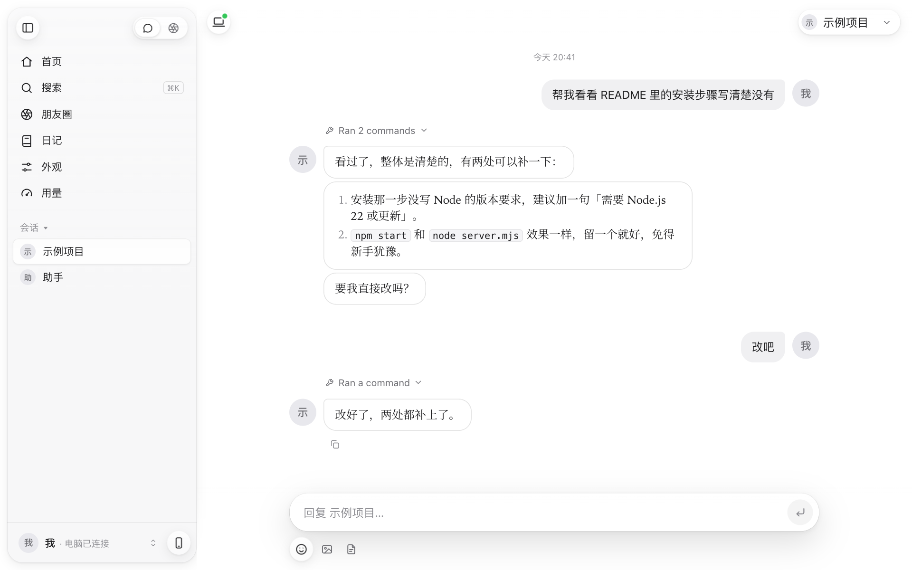

# 0byte

在手机和电脑的浏览器里，用一个简洁的聊天界面，跟你自己电脑上的 Claude Code 对话。

真正干活的是你电脑上的 Claude Code：读代码、改文件、跑命令都在你自己的电脑上。手机和电脑页面只是窗口，聊天记录也只存在你自己的电脑上。

> **非官方项目，跟腾讯、Anthropic 都没有关系。** 需要你自己的 Anthropic API key（在 [Claude Console](https://console.anthropic.com) 申请，按用量计费），或者 Amazon Bedrock、Google Vertex AI、Microsoft Foundry 这类云平台的凭据。

<p align="center">
  
  &nbsp;
  
</p>

<p align="center"></p>

<p align="center"><sub>截图里的对话是演示用的。</sub></p>

## 能做什么

- **手机页和电脑页**：手机打开 `/`，电脑打开 `/desktop.html`，两边是同一份聊天记录。手机上可以「添加到主屏幕」，当成 App 用。
- **一个会话对应电脑上的一个项目目录**，在配置文件里写。
- **审批**：读文件、搜索这类只读操作自动放行。写文件、跑命令之前，页面上会弹卡片，你点「允许 / 总是允许 / 拒绝」。
- **思考块**：回复之前的想法、工具调用、审批卡收进一个可以折叠的块。
- **选择题**：Claude 用 `AskUserQuestion` 出题时，弹出选项让你点。
- **聊天**：
  - 回复按段落拆成气泡。
  - 可以引用某条消息回复、编辑自己的消息重发、让它重新生成。
  - 可以发图片、文件和自己存的表情包。
  - 单独一行 `*摸摸头*` 这样的动作描述，显示成灰色小字。
- **聊天记录**：按日期跳转、搜索、看发过的文件。
- **模型和思考强度**：点顶上的会话名来选，每个会话各存一份。
- **外观**：你和 AI 的名字、头像，聊天背景、背景淡化、气泡透明度、气泡颜色和皮肤、白天 / 夜间。
- **提醒**：页面里的横幅、电脑的系统通知、手机推送。iPhone 要从主屏幕图标打开，并且走 https。
- **用量**：这个 App 花了多少钱（估算），这台电脑上 Claude Code 的用量；API key 也在这里填。
- **陪伴会话（可选）**：见下面「陪伴会话」一节。

## 需要什么

- macOS。目前只在 Mac 上用过；看屏幕、缩图用的是 macOS 自带的命令。
- Node.js 22 或更新的版本。
- 你自己的 Anthropic API key（或者云平台凭据，见下面「API key」）。
- Claude Code 用 Agent SDK 自带的那份就行；你装过 Claude Code 命令行（在 `~/.local/bin/claude`）的话，会优先用你装的。

## 安装和启动

```bash
npm install
cp config.example.json config.json   # 再按自己的项目目录改
node server.mjs                      # 或者 npm start；Mac 上也可以双击 start.command
```

- 第一次启动会生成访问钥匙（存在 `.token`）。
- 终端里会打印一条带钥匙的本机地址（`http://localhost:5173/?t=…`），在浏览器里打开一次，钥匙会记在这个浏览器里。
- 想换端口：`PORT=5199 node server.mjs`。
- `config.json` 写得不对（比如目录不存在），启动时会说清楚是哪一项。

## API key

两种填法，选一种：

- **在页面里填**：侧边栏「用量」→「API」，填好点保存。会先问一下 Anthropic 的接口认不认这个 key（列一下模型，不花钱）。key 存在 `data/api.json`，只存在你自己电脑上，页面只看得到最后 4 位。
- **用环境变量**：启动前 `export ANTHROPIC_API_KEY=你的key`。页面里也填了的话，优先用页面里的。

用云平台或者自己的网关：照 [Claude Code 的文档](https://code.claude.com/docs/en/env-vars) 设好环境变量（`CLAUDE_CODE_USE_BEDROCK`、`CLAUDE_CODE_USE_VERTEX`、`CLAUDE_CODE_USE_FOUNDRY`、`ANTHROPIC_AUTH_TOKEN` 这些）再启动服务，就不用填 key 了。

什么都没设的时候，服务照样能打开，发消息会提示你先去填 key。

## 用手机打开

服务默认只听本机（`127.0.0.1:5173`），手机直接连不上。两种办法：

- **推荐：Tailscale。**
  1. 电脑和手机都装 Tailscale，登录同一个账号。
  2. 在电脑上用 `tailscale serve` 把 5173 端口转出去（具体写法看 Tailscale 的文档）。
  3. 手机用它给的 https 地址，带上 `?t=钥匙` 打开一次。

  手机推送要 https，这个办法自带。
- **在家里的 Wi-Fi 里用**：用 `HOST=0.0.0.0 node server.mjs` 启动，手机打开 `http://电脑的局域网 IP:5173/?t=钥匙`。注意：同一个 Wi-Fi 里拿到钥匙的人，都能让 Claude 在你电脑上干活。

## 配置（config.json）

照 `config.example.json` 改。改完要重启服务。

```json
{
  "timezone": "Asia/Shanghai",
  "pronoun": "TA",
  "chats": [
    { "id": "demo", "name": "示例项目", "cwd": "/path/to/your/project" },
    { "id": "buddy", "name": "助手", "cwd": "/path/to/a/folder/for/your/companion", "companion": true }
  ],
  "proactive": { "enabled": false },
  "compact": { "at": 0.5, "keepTurns": 30 }
}
```

| 字段 | 说明 |
|---|---|
| `timezone` | 你所在的时区。Claude 每轮看到的「现在是几点」、页面上显示的时间都按它。不写就用电脑的。 |
| `pronoun` | 提示词里用第三人称说到你时用的字，比如「她」「他」。默认 TA。 |
| `preamble` | 给所有普通会话加的开场说明（追加在 Claude Code 自带的系统提示后面）。不写用内置的；写成 `""` 就不加。 |
| `chats` | 会话列表，至少一个。见下表。 |
| `proactive` | 让 AI 主动找你，默认关着（每一次都要花 API 的钱）。见「陪伴会话」。 |
| `compact` | 陪伴会话的上下文用到 `at`（比例）时，App 自己压缩：最近 `keepTurns` 轮原文保留，更早的写成摘要。 |
| `weather` | 可选：`{ "city": "北京", "hour": 7 }`，每天这个钟点以后陪伴会话收到的第一条消息附上当天天气。要 DeepSeek 的 key（环境变量 `DEEPSEEK_API_KEY`），没有就不做。 |
| `stickersDir` | 可选：陪伴会话自己的表情包文件夹。文件名就是表情的名字（`抱抱.png`）；文件夹里放一个 `表情包说明.txt`，一行一张「名字：长什么样」，它挑得更准。 |
| `remotionDir` | 可选：一个装好 Remotion 的项目文件夹，陪伴会话借它把动画渲染成视频。不写就没有这个功能。 |
| `diaryDir` | 可选：日记存在哪。默认 `data/diary/`。 |
| `profile` | 可选：`{ "me": { "name": "…" }, "claude": { "name": "…" } }`，你和 AI 的默认名字。在页面「外观」里改也一样。 |

`chats` 里每一项：

| 字段 | 说明 |
|---|---|
| `id` | 只用英文、数字、`-`、`_`。 |
| `name` | 显示的名字（在页面「外观」里也能改）。 |
| `cwd` | 这个会话干活的目录，写完整路径，要是已经存在的文件夹。 |
| `preamble` | 只给这个会话加的说明。 |
| `companion` | `true` = 陪伴会话。只认第一个。 |
| `readDirs` | 另外几个读文件不用审批的目录。 |
| `tools` | 陪伴会话手边摆哪些 Claude Code 自带工具（默认只摆聊天用得上的几样）。 |

## 陪伴会话

给某个会话写上 `"companion": true`，它就不是写代码的助手，而是陪你聊天的。

- **人设由你写**：放在这个会话工作目录（`cwd`）的 `CLAUDE.md` 里，写它是谁、怎么说话、你们之间的事。短的也可以写在会话的 `preamble` 里。App 只交代场合和格式，不写性格。
- **它的名字和头像**：默认用 config.json 里这个会话的 `name`，在页面「外观」里改。
- **朋友圈**：你和它都能发动态（可以带图）、点赞、评论；你发的它会看到，自己决定回不回。
- **日记**：你们各写各的，日记页按天并排看。你交了新日记它会马上看到；它用工具写自己的。
- **闹钟**：你让它到点叫你、提醒你，它可以给自己定闹钟。
- **搜图发图、气泡皮肤、做小玩意**：它能搜可以自由使用的图库、把图发给你，给你做聊天气泡皮肤，在工作目录的 `小玩意/` 文件夹里做网页、SVG 小作品（放了 three.js、p5.js 的话也能用，见下面），还能截图看看自己做的东西。
- **看屏幕、一起看**：它能截一张你主屏幕看看；你开了「一起看」，它每隔几分钟看一眼。只有 macOS 能用，还要在「系统设置 → 隐私与安全性 → 屏幕录制」里给运行这个服务的程序（终端或 node）权限。
- **主动找你**（要在 `proactive` 里打开）：每天随机醒来几次，自己选发消息、发朋友圈，还是不打扰你；你一阵子没回，它决定要不要问一句。次数和时段在 `proactive.companion`（`day`、`night`、`nightStart`、`nightEnd`、`dayEnd`）和 `proactive.silence`（`hours`、`from`、`to`）里改。醒来的那几轮不弹审批卡（你可能在睡觉），要审批的事一律不做。
- **自动压缩**：见上面 `compact`。

## three.js 和 p5.js（可选）

陪伴会话「做小玩意」时可以用这两个库。仓库里不带，要用的话自己下载，放进 `public/vendor/`，文件名要一字不差：

| 放成这个文件 | 从哪下 |
|---|---|
| `public/vendor/three.min.js` | three.js 要用 0.160 或更早的版本（新版本不再提供 `three.min.js` 这种单文件）：<https://cdn.jsdelivr.net/npm/three@0.160.0/build/three.min.js>，官网 <https://threejs.org> |
| `public/vendor/p5.min.js` | p5.js：<https://cdn.jsdelivr.net/npm/p5@1.11.2/lib/p5.min.js>，官网下载页 <https://p5js.org/download/> |

```bash
cd public/vendor
curl -LO https://cdn.jsdelivr.net/npm/three@0.160.0/build/three.min.js
curl -LO https://cdn.jsdelivr.net/npm/p5@1.11.2/lib/p5.min.js
```

放了哪个，它才会用哪个；一个都没放，它就用原生的 Canvas、SVG、CSS 做。放进去就能用，不用重启服务。

## 花费

- 「用量」里的花费是这个 App 自己算的：每次调模型实际用的 token（输入、读缓存、写缓存、输出）× 官方价格。只算这个 App 里的对话（醒来、朋友圈这些自动的也算），实际以 Claude Console 里的账单为准。
- 价格表在 `server.mjs` 的 `API_PRICE` 里，照 [官方价格页](https://platform.claude.com/docs/en/about-claude/pricing) 写的。出了新模型或者调了价，要去那里改；表里没有的模型，先用 Claude Code 自己的估算。
- 主要的钱花在每一轮要把整个上下文重读一遍（有提示缓存，会便宜很多）。上下文越长，每句话越贵；陪伴会话到一定比例会自动压缩。
- 主动找你、一起看这些自动的轮次，每一次也要花钱，所以默认关着。

## 数据存在哪

全在 `data/` 里，不进 git：聊天记录、上传的图片和文件、日记、朋友圈、外观设置、推送用的钥匙、页面里填的 API key 等。

- 会话文件只留最近 500 条，更早的存在 `<id>.archive.jsonl`，不会丢。
- 删掉 `data/` 就是清空所有记录。

## 安全

- **拿到钥匙（`.token`）的人，就能让 Claude 在你电脑上读写文件、跑命令**（写文件、跑命令前还是要在页面上点允许）。钥匙别外传。
- 换钥匙：删掉 `.token`，重启服务。用过的浏览器要用新地址重新打开一次。
- 服务默认只听本机。别把端口直接开到公网上：页面这些静态文件打开不用钥匙；聊天里发的文件，地址里那串随机编号就是钥匙，拿到地址的人就能打开。
- 钥匙不对、被挡掉的请求，会在服务日志里记一行 `[门铃]`。
- 不用审批、直接放行的：
  - Claude Code 的只读工具：`Read`、`Glob`、`Grep`、`WebFetch`、`WebSearch`，还有 `TodoWrite`、`NotebookRead`、`BashOutput`、`Task`、`Skill`；
  - 这个 App 自己的工具：发文件、朋友圈、日记、闹钟、搜图这些；
  - 陪伴会话还多三样：在工作目录 `小玩意/` 里写文件；用 `python3` 跑 `小玩意/脚本/` 里的 `.py`（注意脚本能读你电脑上的任何文件）；用 `screencapture` 截屏存到 `小玩意/截屏/`。不想要的话，改 `server.mjs` 里的 `playFreeEdit`、`freeBash`。

## 已知限制

- 只在 macOS 上试过。`start.command` 用 `caffeinate` 防睡眠；缩图用 `sips`，截屏用 `screencapture`，都是 macOS 自带的。
- 「用量」里的明细用到 Agent SDK 里标着「实验、可能会改」的接口，SDK 升级后可能读不到（花费那一块不受影响）。
- 陪伴会话看自己做的网页要用浏览器：找的是 Remotion 带的 chrome-headless-shell，或者 macOS 上装在默认位置的 Google Chrome。
- `tools/cdp.mjs`（测界面用的截图小工具）写死了 macOS 上 Chrome 的路径。

## 第三方

- [Claude Agent SDK](https://code.claude.com/docs/en/agent-sdk/overview)（`@anthropic-ai/claude-agent-sdk`）：只作为依赖，使用受 Anthropic 的条款约束。
- zod（MIT）：作为依赖。
- 思源宋体（Noto Serif SC）：SIL Open Font License 1.1，见 `public/vendor/fonts/LICENSE-OFL.txt`。
- three.js（MIT）、p5.js（LGPL-2.1）：仓库里不带，要用的话自己下载（见上面「three.js 和 p5.js」），使用受各自许可证约束。

## 许可证

[MIT](LICENSE)。第三方的部分按各自的许可证，见上面「第三方」。
